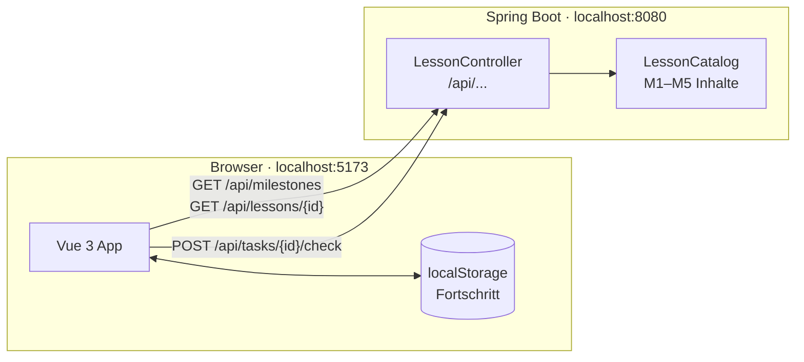

<p align="center">
  
</p>

<h1 align="center">Project RekSai</h1>

<p align="center">
  <strong>Lerne Schritt für Schritt, wie man genau diese App baut.</strong><br>
  Von den ersten Zeilen Java bis zur fertigen Web-App mit Spring Boot und Vue.
</p>

<p align="center">
  
  
  
  
  
</p>

---

Project RekSai ist eine Lernplattform nach dem Prinzip von Duolingo, mit eigenem Look. Das Besondere: Der Lernpfad bringt dir
genau das bei, was in diesem Projekt steckt. Er ist in die Meilensteine des Projekts unterteilt,
und jeder Meilenstein enthält alle Skills, die man für diesen Teil braucht.

Dieses Repository ist das **Frontend** (Vue 3). Das Backend liegt in
[Web-Technologien-3](https://github.com/TomYang05/Web-Technologien-3).

## Inhalt

- [Was die App kann](#was-die-app-kann)
- [Der Lernpfad](#der-lernpfad)
- [So läuft eine Lektion ab](#so-läuft-eine-lektion-ab)
- [Architektur](#architektur)
- [Schnellstart](#schnellstart)
- [Projektstruktur](#projektstruktur)
- [Wie es funktioniert](#wie-es-funktioniert)
- [Tests und Qualität](#tests-und-qualität)
- [Design](#design)

## Was die App kann

- **Lernpfad zum Freischalten:** 36 Lektionen in 5 Meilensteinen. Jede bestandene Lektion schaltet
  die nächste frei, über Meilensteine hinweg.
- **Vier Phasen pro Lektion:** Lektion → Lesen → Lernen → Anwenden.
- **Zwei Aufgabentypen:** Multiple Choice und freie Eingabe von Code. Antworten prüft das Backend,
  Leerzeichen spielen dabei keine Rolle.
- **XP, Level und Fortschritt:** XP pro richtiger Antwort, Bestwert pro Lektion, Level alle 100 XP,
  beides im Header.
- **Tastatursteuerung:** `1`–`4` wählt eine Option, `Enter` prüft und geht weiter.
- **Hell und dunkel, Handy und Desktop:** passt sich Systemfarbschema und Bildschirmbreite an.

## Der Lernpfad

| Meilenstein | Thema | Lektionen | Im Projekt |
| --- | --- | :---: | --- |
| **M1** | Backend mit Spring Boot: Java-Grundlagen, Records, Listen, REST-Controller, HTTP und JSON | 8 | umgesetzt |
| **M2** | Frontend mit Vue: HTML, CSS, JavaScript, Vite, Komponenten, Reaktivität, `v-for` | 8 | umgesetzt |
| **M3** | Frontend trifft Backend: async/await, `fetch`, `onMounted`, CORS, Umgebungsvariablen, POST | 6 | umgesetzt |
| **M4** | Datenbank und Persistenz: SQL, PostgreSQL, JPA-Entities, Repositories, Beziehungen | 7 | geplant |
| **M5** | Login und Level-System: Passwort-Hashing, Spring Security, JWT, Login-Formular, XP auf dem Server | 7 | geplant |

Insgesamt 86 Lesetexte und 155 Aufgaben. Meilensteine mit „geplant“ kann man in der App schon
lernen. Im Code dieses Projekts werden sie als Nächstes gebaut.

## So läuft eine Lektion ab

```
  ┌──────────┐    ┌──────────┐    ┌──────────┐    ┌───────────┐
  │ Lektion  │ ─▶ │  Lesen   │ ─▶ │  Lernen  │ ─▶ │ Anwenden  │
  │ Ziel und │    │ kurze    │    │ Multiple │    │ Code      │
  │ Überblick│    │ Texte    │    │ Choice   │    │ eintippen │
  └──────────┘    └──────────┘    └──────────┘    └───────────┘
```

1. **Lektion:** Meilenstein, Nummer (z. B. 2.6), Ziel und wie viel in jeder Phase kommt.
2. **Lesen:** kurze Erklärtexte mit Codebeispielen. Man kann vor- und zurückblättern.
3. **Lernen:** Multiple-Choice-Fragen, sofortiges Feedback mit Erklärung.
4. **Anwenden:** Code oder Begriffe selbst eintippen.

Mit mindestens **50 %** richtigen Antworten ist die Lektion bestanden und die nächste wird frei.

## Architektur



- Das **Backend** liefert Meilensteine, Lektionen und Aufgaben als JSON und prüft Antworten.
  Musterlösungen verlassen den Server nur nach dem Antworten.
- Das **Frontend** zeigt den Lernpfad, führt durch die Lektionen und merkt sich den Fortschritt.
  Bis Datenbank und Login (M4/M5) gebaut sind, liegt er im `localStorage` des Browsers.

## Schnellstart

Voraussetzungen: **Node.js** 22.18+ oder 24.12+, **JDK 25**.

**1. Backend starten** (im Repository `Web-Technologien-3`):

```sh
./gradlew bootRun
```

**2. Frontend starten** (in diesem Repository):

```sh
npm install
npm run dev
```

Danach läuft die App unter **http://localhost:5173**.

Die Backend-URL steht in `.env.development` (`VITE_BACKEND_BASE_URL`, Standard
`http://localhost:8080`). Für ein Deployment setzt man die Variable beim Build auf die echte URL.

| Befehl | Zweck |
| --- | --- |
| `npm run dev` | Dev-Server mit Hot Reload |
| `npm run build` | Typecheck und Production-Build nach `dist/` |
| `npm run test:unit` | Unit-Tests mit Vitest |
| `npm run lint` | oxlint und ESLint |
| `npm run format` | Code mit Prettier formatieren |

## Projektstruktur

```
src/
├── api.ts                 Typen und fetch-Funktionen für das Backend
├── progress.ts            Fortschritt, Freischalt-Logik, XP (localStorage)
├── main.ts                Einstieg: Fonts, CSS, Router, mount('#app')
├── App.vue                Header mit Logo und XP, Seitenübergänge
├── router/index.ts        Routen: / und /lessons/:id
├── views/
│   ├── HomeView.vue       Lernpfad nach Meilensteinen
│   └── LessonView.vue     Ablauf einer Lektion (Phasen, Zusammenfassung)
├── components/
│   ├── ReadingCard.vue    Phase „Lesen“: Text, Listen, Inline-Code, Code-Block
│   ├── TaskCard.vue       Phasen „Lernen“ und „Anwenden“: Frage, Optionen, Eingabe, Feedback
│   └── LogoMark.vue       Logo als SVG-Komponente
└── assets/
    ├── base.css           Farben (hell/dunkel), Schriften, Grundstile
    └── main.css           Buttons, Lade- und Fehlerzustände
public/favicon.svg         Logo und Favicon
```

## Wie es funktioniert

### Daten laden

`api.ts` kapselt alle Aufrufe ans Backend. Die Startseite lädt `GET /api/milestones`, eine Lektion
lädt `GET /api/lessons/{id}` und `GET /api/lessons` (für Sperre und „nächste Lektion“). Antworten
schickt `checkAnswer` per `POST /api/tasks/{id}/check`.

### Freischalten und Fortschritt

`progress.ts` ist die einzige Stelle, die den Fortschritt kennt:

- `recordResult(id, xp, accuracy)` speichert das beste Ergebnis, ab 50 % gilt die Lektion als bestanden.
- `lessonState(lesson, lessons)` liefert `completed`, `current` oder `locked`. Die Reihenfolge ergibt
  sich aus Meilenstein und Position.
- `totalXp` summiert die besten XP aller Lektionen.

Der Fortschritt liegt im `localStorage` unter `project-reksai-progress`. Für M4 wird nur diese Datei
auf API-Aufrufe umgestellt, die Komponenten bleiben gleich.

### Eine Lektion

`LessonView.vue` steuert die Phasen `intro → read → task → done`. Lesetexte zeigt
`ReadingCard.vue`, Aufgaben `TaskCard.vue`. Die Phase „Lernen“ sind die Multiple-Choice-Aufgaben,
„Anwenden“ die Eingabe-Aufgaben. Das Backend liefert sie schon in dieser Reihenfolge. Gesperrte
Lektionen zeigen auch per direkter URL nur einen Hinweis auf die vorige Lektion.

### Lesetexte

Die Texte kommen als einfacher Text vom Backend. `ReadingCard.vue` macht daraus Absätze
(Leerzeile), Aufzählungen (`- ` am Zeilenanfang) und Inline-Code (`` `Backticks` ``). Alles wird als
Text gerendert, nie als HTML. So kann im Inhalt kein Code ausgeführt werden.

## Tests und Qualität

```sh
npm run test:unit -- --run
npm run build
npm run lint
```

| Testdatei | Prüft |
| --- | --- |
| `src/__tests__/progress.spec.ts` | Freischalten über Meilensteine, 50-%-Grenze, Bestwerte, localStorage |
| `src/components/__tests__/TaskCard.spec.ts` | Optionen, Tastatur, Eingabe, Lösung bei falscher Antwort |
| `src/components/__tests__/ReadingCard.spec.ts` | Absätze, Listen, Inline-Code, kein HTML |
| `src/views/__tests__/HomeView.spec.ts` | Lernpfad, Sperren, „Geplant“-Kennzeichen, Fehlerfall |
| `src/views/__tests__/LessonView.spec.ts` | Ganzer Durchlauf Lektion → Lesen → Lernen → Anwenden |

## Design

Das System (Lernpfad, XP, Freischalten) ist von Duolingo inspiriert, der Look ist eigen: **Kristall**.

- **Formen:** Karten mit abgeschnittenen Ecken, Buttons als Parallelogramme, Lektionen als
  Sechseck-Kacheln in einer Wabe, Fortschritt als schräge Splitter. Die Formen stehen als
  `--shape-card`, `--shape-slant` und `--shape-hex` in `src/assets/base.css`.
- **Farben:** Signature-Farbe `#272F7A` (Indigo). Aus dem Logo kommen **Magenta** (geschafft, XP)
  und **Türkis** (aktuell, richtig). Jeder Meilenstein hat eine eigene Kennfarbe für sein Abzeichen.
- **Hell und dunkel:** Dunkel ist der Hauptlook, die helle Variante folgt dem System.
- **Schriften:** Space Grotesk für Text, JetBrains Mono für Code, beide lokal über `@fontsource`
  eingebunden (keine Anfragen an Google). Ligaturen sind aus, damit `=`, `==` und `===` klar
  unterscheidbar bleiben.
- **Logo:** drei Kristallkrallen, als `public/favicon.svg` und als Komponente `LogoMark.vue`.
- **Barrierefreiheit:** Weil `clip-path` den normalen Fokusrahmen abschneidet, zeigen Buttons und
  Antworten den Tastaturfokus als inneren Türkis-Rahmen. Bewegungen sind aus, wenn das System
  „Bewegung reduzieren“ eingestellt hat.

---

<sub>Uni-Projekt im Modul Web-Technologien, WS 2026/27. Rek'Sai und „PROJECT“ sind Marken von Riot
Games. Das Projekt steht in keiner Verbindung zu Riot Games.</sub>
